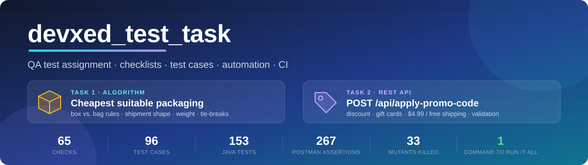
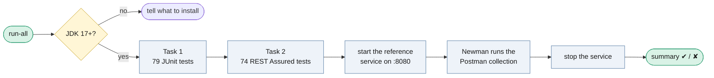

<div align="center">



<br>

[](https://github.com/DmitryDerkach/devxed_test_task/actions/workflows/ci.yml)


**Solution of a two-part QA test assignment: checklists first, then everything that proves they work.**

[Task 1 · Packaging](Task%201/README.md) &nbsp;•&nbsp; [Task 2 · Promo-code API](Task%202/README.md) &nbsp;•&nbsp; [Quick start](#-quick-start) &nbsp;•&nbsp; [How it was built (AI-DLC)](#-how-it-was-built-ai-dlc) &nbsp;•&nbsp; [Original assignment (PDF)](Задание.pdf)

</div>

---

## 📌 The assignment in one minute

The original task is in [`Задание.pdf`](Задание.pdf) (English text). It has two parts, and for each one **the required deliverable is a checklist**:

| | Task | What the checklist covers |
|:-:|---|---|
| 📦 | **[Task 1 · Packaging selection](Task%201/README.md)** | An algorithm that suggests to a warehouse employee the **cheapest available packaging** (box or bag) a shipment fits into. Boxes are rigid (dimensions compared position by position), bags stretch (`Max + Min ≤ length`, `Mid + Min ≤ width`). |
| 🏷️ | **[Task 2 · `POST /api/apply-promo-code`](Task%202/README.md)** | Business logic of a promo-code endpoint: gift cards are excluded from the discount, shipping is **$4.99** or **free from $35.00**, digital-only carts are not shipped, the discount is applied before shipping. |

> [!NOTE]
> The task says: *“If the description lacks some details, make your own assumptions and state them in your answer.”*
> Every gap that was found is closed by an explicit, numbered **assumption** (10 for Task 1, 13 for Task 2), and every check that depends on one says so.

---

## 🗂️ What is in the repository

```text
devxed_test_task/
├── README.md                    ← you are here
├── Задание.pdf                  ← the original assignment
├── run-all.cmd / .ps1 / .sh     ← ONE command that runs every test
├── .github/workflows/ci.yml     ← the same run on GitHub Actions (Linux + Windows)
│
├── Task 1/                      📦 packaging selection
│   ├── README.md                ← detailed write-up: rules, diagrams, techniques, assumptions
│   ├── Checklist_EN.xlsx        ★ MAIN DELIVERABLE (31 checks)
│   ├── Checklist_EN.md            the same checklist, readable right here on GitHub
│   ├── images/                    diagrams used by the README
│   └── Additional/
│       ├── Checklist_RU.xlsx      Russian version of the checklist
│       ├── Test cases/            44 test cases (EN + RU), Azure DevOps import layout
│       └── Automation/            Java 17 · JUnit 5 · AssertJ · mutation check (79 tests)
│
└── Task 2/                      🏷️ POST /api/apply-promo-code
    ├── README.md                ← detailed write-up
    ├── Checklist_EN.xlsx        ★ MAIN DELIVERABLE (34 checks)
    ├── Checklist_EN.md
    └── Additional/
        ├── Checklist_RU.xlsx
        ├── Test cases/            52 test cases (EN + RU), Azure DevOps import layout
        ├── Automation/            reference service + REST Assured tests + mutation check (74 tests)
        └── Postman/               collection (48 requests, 267 assertions) + environment
```

| | Task 1 📦 | Task 2 🏷️ |
|---|:-:|:-:|
| ★ Checklist (EN, main deliverable) | **31 checks** | **34 checks** |
| Assumptions | 10 | 13 |
| Test cases (Azure DevOps layout, EN + RU) | 44 | 52 |
| Automated Java tests | 79 | 74 |
| Deliberately broken versions (mutants) the tests must catch | 16 / 16 caught | 17 / 17 caught |
| Postman / Newman | – | 48 requests · 267 assertions |

Each sheet of `Checklist_EN.xlsx`: **Checklist** (check · expected result · why it matters · technique · priority · linked test cases), **Assumptions**, **Techniques** (where each test-design technique was used, and where it deliberately was not).

---

## 🚀 Quick start

You need **JDK 17+** (Maven is downloaded automatically by the wrapper) and **Node.js 18+** (only for the Postman/Newman part, it is skipped with a warning if Node is missing).

```bash
git clone https://github.com/DmitryDerkach/devxed_test_task.git
cd devxed_test_task
```

| OS | Run everything |
|---|---|
| 🪟 Windows | double-click **`run-all.cmd`** &nbsp;or&nbsp; `powershell -ExecutionPolicy Bypass -File .\run-all.ps1` |
| 🍎 macOS / 🐧 Linux / Git Bash | `./run-all.sh` |

What happens:



Expected output (a real run):

```text
▶ Task 1 · Packaging selector (JUnit 5 + AssertJ + mutation check)
  ✔ Task 1 · Java tests: 79 tests, 0 failed  (5 s)
▶ Task 2 · Promo-code API (REST Assured + mutation check)
  ✔ Task 2 · Java tests: 74 tests, 0 failed  (11 s)
▶ Task 2 · Postman collection (Newman against the reference service)
  ✔ service is up
  ✔ Newman: 48 requests, 267 assertions, 0 failed

  Summary
  ──────────────────────────────────────────────────────────
  ✔  Task 1 · Java tests         79 tests, 0 failed
  ✔  Task 2 · Java tests         74 tests, 0 failed
  ✔  Task 2 · Postman / Newman   48 requests, 267 assertions, 0 failed
  ──────────────────────────────────────────────────────────
  All green.
```

The first run downloads Maven and the dependencies (~1–2 min); later runs take ~30 s. Logs land in `.run-logs/`, JUnit reports in `**/target/surefire-reports/`. Port busy? `PORT=8090 ./run-all.sh` or `.\run-all.ps1 -Port 8090`.

Prefer to run one part by hand, open the Postman collection in the Postman app, or import the test cases into Azure DevOps? Each task README has a step-by-step section.

---

## 🤖 How it was built (AI-DLC)

Instead of the classic STLC (*requirements → planning → design → execution → closure*, one long hand-made pass), the work followed the **AI-Driven Development Life Cycle (AI-DLC)**. Its core idea: **the human owns the intent, every decision and every gate; the AI agent executes in short iterations between those gates.** Here the human is the author of this repository (QA engineer, in the roles of product owner, test lead and reviewer), and the agent is Claude Code.

```mermaid
flowchart LR
    H0{{"👤 Intent<br/>scope, structure,<br/>definition of done"}} --> A1
    subgraph I["① Inception"]
        direction TB
        A1["🤖 read the spec,<br/>list every gap"] --> H1{{"👤 Gate 1<br/>decide each<br/>assumption"}}
    end
    subgraph C["② Construction"]
        direction TB
        A2["🤖 draft checklist,<br/>test cases, automation"] --> H2{{"👤 Gate 2<br/>review every artefact,<br/>reject / rework"}}
        H2 -- "rework" --> A2
    end
    subgraph O["③ Operations"]
        direction TB
        A3["🤖 mutation check,<br/>one-command run, CI"] --> H3{{"👤 Gate 3<br/>approve release,<br/>verify as a reviewer"}}
    end
    H1 --> A2
    H2 -- "approved" --> A3
    H3 --> P(["🚀 published"])

    classDef ai fill:#eef3f9,stroke:#5b7fa6,color:#1a1a1a
    classDef human fill:#fff6d6,stroke:#c9a227,color:#1a1a1a,font-weight:bold
    classDef done fill:#d9f2e6,stroke:#2f9e73,color:#1a1a1a
    class A1,A2,A3 ai
    class H0,H1,H2,H3 human
    class P done
```



### 👤 What the human decided

| Gate | Decision | Effect on the result |
|---|---|---|
| **Intent** | No questions to an analyst: the task explicitly allows own assumptions, so every gap is closed by a stated assumption instead | the *Assumptions* sheets, referenced from each affected check |
| **Intent** | The checklist is the deliverable; test cases, automation and Postman are optional extras | the `Task N/` vs `Task N/Additional/` split of this repository |
| **Gate 1** | Approved the reading of the ambiguous rules, incl. the two that change the most expected results: free-shipping threshold checked **before** the discount, and *digital + gift card* is **not** “digital only” | Task 2 assumptions #6 and #7, checks `PC-11`, `PC-15` |
| **Gate 1** | Required the bag formula to be explained **with pictures and numbers**, step by step, and clearly marked as an explanation, not part of the spec | the 8 diagrams in the [Task 1 README](Task%201/README.md#3-the-rules-explained-with-pictures) |
| **Gate 2** | Rejected the first version of the test cases: internal names like `Box-Next`, `Box-Limit` are not in the spec → **neutral names** (`Box 1`, `Bag 1`) everywhere, checklist included | all test cases and checklists |
| **Gate 2** | Rejected “Request is prepared” as a step: step 1 is a **precondition** with expected result “–” | the step layout of all 96 test cases |
| **Gate 2** | Rejected invented response texts (`'Promo code applied successfully'`): the spec does not define them, so test cases must not prescribe them | Task 2 expected results |
| **Gate 2** | Required expected results to be written out **in full**, with the arithmetic | every *Expected Result* cell |
| **Gate 2** | Trimmed the Azure DevOps layout (no *Comments / Area Path / Assigned To / State*) and renamed the columns | both `TestCases_*.xlsx` |
| **Gate 3** | Chose *script + CI* over Docker after comparing the options; defined the repository structure and the README standard | `run-all.*`, `.github/workflows/ci.yml`, this README |
| **Gate 3** | Reviewed the repository before publishing, then cloned it as an ordinary reviewer and ran it | this release |

### 🤖 What the AI did

| Phase | Work | Where to see it |
|---|---|---|
| **① Inception** | Read the spec line by line and turned every place where two testers could expect different results into an open question with a proposed answer | *Assumptions* sheets |
| **② Construction** | Drafted 65 checks with EP · BVA · decision tables · pairwise · error guessing; derived 96 test cases, the Java tests and the Postman collection **from the same scenarios**, so they cannot disagree; redid them after each review | `Checklist_EN.*`, `Additional/` |
| **③ Operations** | Wrote 33 deliberately broken versions of the code (`>` instead of `≥`, gift cards discounted, threshold after discount …) that the suite must catch; built the one-command run and the CI on Linux and Windows | `Additional/Automation/`, `run-all.*`, Actions tab |

**Why it matters for QA:** the AI made breadth cheap (every boundary, every combination, two languages, executable proof). The human kept everything that needs judgement: what the spec *means*, which risks matter, what a good test case reads like, and when the work is good enough to ship.

---

## ⚖️ Honest notes

* **There is no real system behind the assignment.** To make the checklists executable, each task has a small **reference implementation** of the spec *plus the stated assumptions*. Green tests mean *“the checklist is executable and catches real defects”* (see the mutants), not *“someone else’s backend is correct”*. Point the Postman environment at a real server to test one.
* Response **texts** (`message`) are not defined by the assignment. The test cases therefore do not prescribe them; the reference service uses its own texts, and only the automation checks them.
* The checklist is the main deliverable; everything under `Additional/` is supporting material.

<div align="center">
<br>

**[📦 Task 1 README →](Task%201/README.md)** &nbsp;&nbsp;&nbsp; **[🏷️ Task 2 README →](Task%202/README.md)**

</div>
