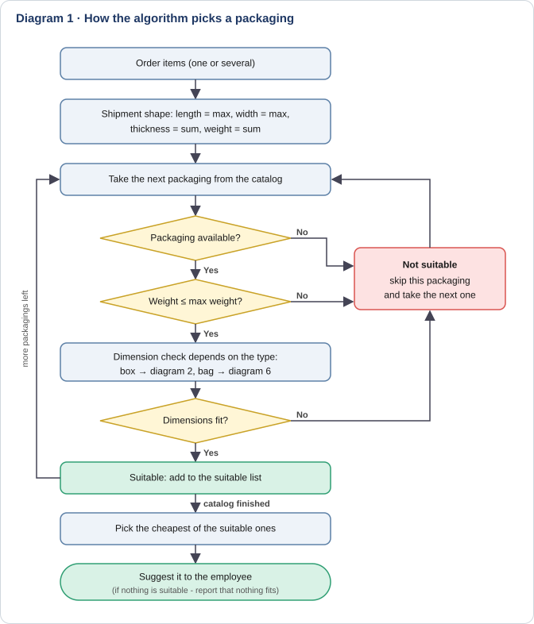
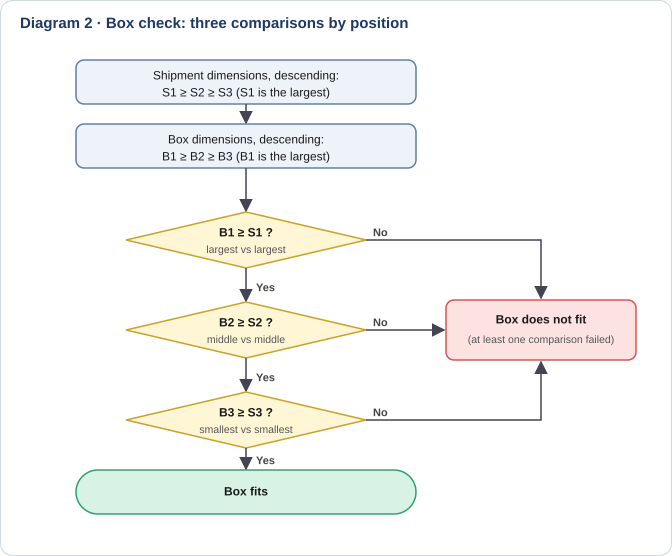
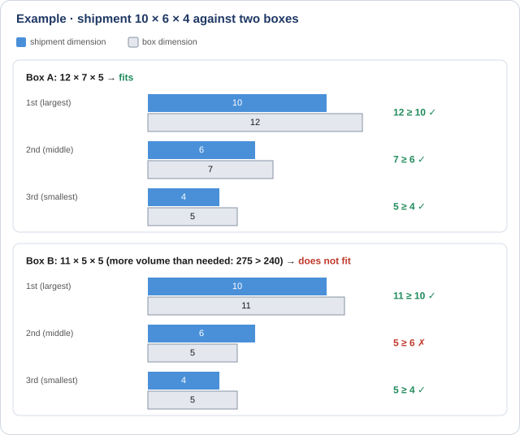
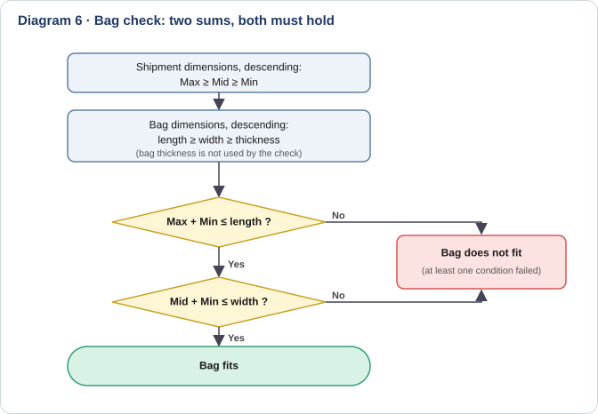
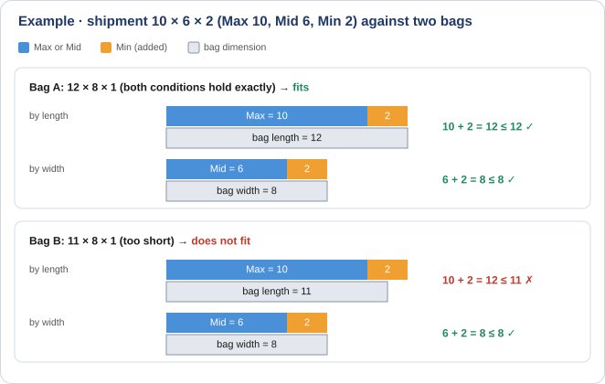
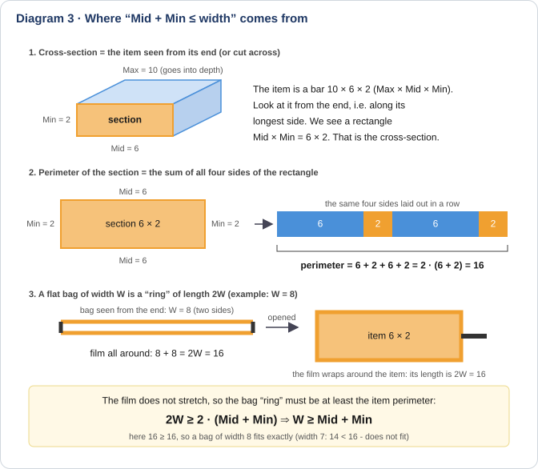
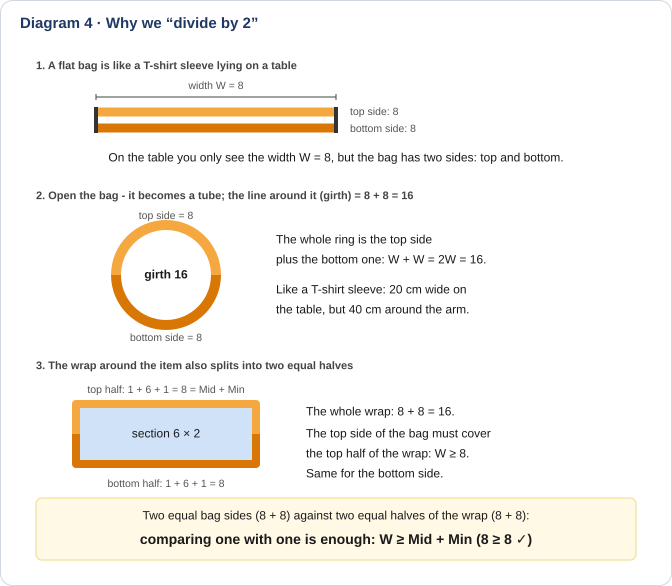
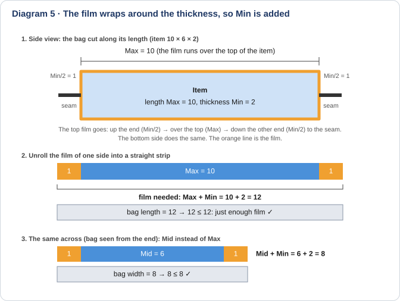
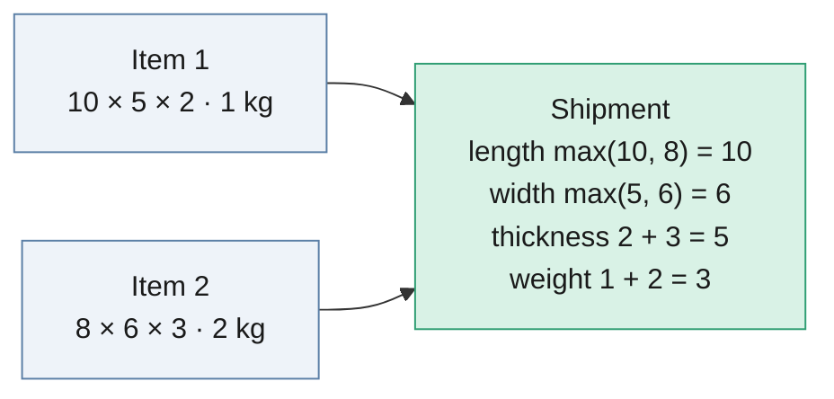
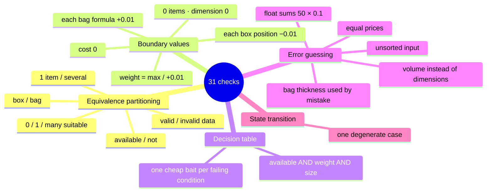

<div align="center">

# 📦 Task 1 · Cheapest suitable packaging

**Checklist for an algorithm that suggests to a warehouse employee the cheapest available packaging a shipment fits into**


[⬅ Back to the repository overview](../README.md) &nbsp;•&nbsp; [★ Checklist (read on GitHub)](Checklist_EN.md) &nbsp;•&nbsp; [★ Checklist_EN.xlsx](Checklist_EN.xlsx)

</div>

---

## Contents

1. [Deliverables](#1-deliverables)
2. [The task](#2-the-task)
3. [The rules, explained with pictures](#3-the-rules-explained-with-pictures)
   [3.1 Overall flow](#31-overall-flow) · [3.2 Box](#32-box) · [3.3 Bag](#33-bag) · [3.4 Where the bag formula comes from](#34-where-the-bag-formula-comes-from) · [3.5 Worked example](#35-worked-example-from-order-to-packaging)
4. [Assumptions](#4-assumptions)
5. [How the checklist was designed](#5-how-the-checklist-was-designed)
6. [The checklist at a glance](#6-the-checklist-at-a-glance)
7. [Test cases](#7-test-cases)
8. [Automation](#8-automation)
9. [How to run](#9-how-to-run)

---

## 1. Deliverables

| | File | What it is |
|:-:|---|---|
| ★ | [`Checklist_EN.xlsx`](Checklist_EN.xlsx) | **The main deliverable.** Sheets: *Checklist* (31 checks `PK-01 … PK-31`), *Assumptions* (10), *Techniques* |
| ★ | [`Checklist_EN.md`](Checklist_EN.md) | The same checklist rendered as Markdown, so it can be read right here on GitHub |
| | [`Additional/Checklist_RU.xlsx`](Additional/Checklist_RU.xlsx) | Russian version of the checklist |
| | [`Additional/Test cases/`](Additional/Test%20cases) | 44 test cases in EN and RU, Azure DevOps import layout |
| | [`Additional/Automation/packaging-selector/`](Additional/Automation/packaging-selector) | Java 17 reference implementation + 79 JUnit 5 tests + mutation check |
| | [`images/`](images) | The diagrams below |

**ID scheme:** checks are `PK-01 … PK-31`; a test case is `PK-<check>.<n>`, so `PK-12.1` is the first test case of check `PK-12`. The same IDs are used in the checklist, the test cases and the JUnit test names, so you can trace any line in any direction.

---

## 2. The task

> *Create a checklist for testing an algorithm which suggests to an employee what packaging to use for shipping an order: **the cheapest one among all available packaging options that the shipment fits into.***
> — from [`Задание.pdf`](../Задание.pdf)

**Input data**

| Item (a single unit) | Packaging option |
|---|---|
| weight | name |
| dimensions: length, width, thickness | cost |
| | availability: available / not available |
| | type: **box** (rigid, fixed dimensions) or **bag** (stretches) |
| | maximum weight |
| | three internal dimensions |

**Shipment shape**: one item → its own weight and dimensions. Several items are **stacked**:

| | Rule |
|---|---|
| length | **max** length across the items |
| width | **max** width across the items |
| thickness | **sum** of thicknesses |
| weight | **sum** of weights |

**A packaging is suitable when all of these hold:** it is available · the shipment does not exceed its maximum weight · the dimension check for its type passes (box and bag have different checks, explained below).

---

## 3. The rules, explained with pictures

> [!TIP]
> Everything a shipment has is three numbers. Before any comparison they are **sorted in descending order** and called **Max ≥ Mid ≥ Min**. For an item `10 × 6 × 2`: Max = 10, Mid = 6, Min = 2. The order in which the dimensions were *entered* therefore never matters: `4, 10, 6` and `10, 6, 4` are the same item.

### 3.1 Overall flow

Filters first (availability → weight → dimensions), then the cheapest of the survivors.

<p align="center"></p>

### 3.2 Box

**Rule.** Sort the three shipment dimensions and the three box dimensions in descending order and compare them **position by position**: largest with largest, middle with middle, smallest with smallest. Every box dimension must be **greater than or equal** to the shipment dimension in the same position. Equality is allowed: an item exactly the size of the box fits.

**Why sorting?** A box is rigid, but the item can be laid in any orientation. The best way is longest side along the longest side, and sorting both triples does exactly that.

<table>
<tr>
<td width="50%"></td>
<td width="50%"></td>
</tr>
</table>

> [!IMPORTANT]
> **Dimensions, not volume.** Box B (11 × 5 × 5) has a volume of 275 and the shipment (10 × 6 × 4) only 240, yet it does **not** fit: its middle dimension 5 is smaller than 6. Comparing volumes is a classic bug, so there is a dedicated check for it (`PK-14`).

### 3.3 Bag

**Rule** (given by the task as is). Sort the shipment: Max, Mid, Min. Sort the bag dimensions and call them *length ≥ width ≥ thickness*. The bag fits when **both** hold:

$$\text{Max} + \text{Min} \le \text{bag length} \qquad\text{and}\qquad \text{Mid} + \text{Min} \le \text{bag width}$$

The bag's third dimension (thickness) is **not used** by the check. Equality is allowed.

<table>
<tr>
<td width="50%"></td>
<td width="50%"></td>
</tr>
</table>

A bag `12 × 7 × 1` would not fit either: the length passes (12 ≤ 12), the width does not (8 ≤ 7 is false). **Both** conditions are required.

**Why bags exist at all?** They rescue the shapes a box cannot take:

| Shipment | Box | Bag |
|---|---|---|
| Flat and wide: `30 × 20 × 0.5` | `25 × 25 × 25` ❌ the largest dimension 25 < 30 | `31 × 21 × 5` ✅ 30 + 0.5 = 30.5 ≤ 31 and 20 + 0.5 = 20.5 ≤ 21 |
| Small and thick: `5 × 5 × 5` | `4 × 4 × 4` ❌ 4 < 5 in every position | `10 × 10 × 3` ✅ 5 + 5 = 10 ≤ 10 twice (the bag thickness 3 is not checked) |

### 3.4 Where the bag formula comes from

> [!NOTE]
> The formula is simply **part of the assignment**: it has to be applied, not justified. The pictures below are *one possible explanation* that makes it intuitive. They are **not** part of the task and nothing in the checklist depends on them.

Think of a flat bag as an envelope of film: two sides sealed at the edges. A thin sheet takes almost all the space inside. A **thick** item puffs the bag up, and the film has to go around its thickness too, up one end, over the top, down the other end. That detour is the extra **Min**.

<details open>
<summary><b>Step 1–3 · cross-section, perimeter, the bag as a ring</b></summary>
<br>
<p align="center"></p>

* **Cross-section** = what you see looking at the item from its end: a `Mid × Min` rectangle (6 × 2).
* **Perimeter** of that rectangle = `Mid + Min + Mid + Min = 2 · (Mid + Min)` = 16.
* A flat bag of width **W** opened up is a ring of film of length **2W**. The film does not stretch, so `2W ≥ 2 · (Mid + Min)` ⇒ **`W ≥ Mid + Min`**.
</details>

<details open>
<summary><b>Step 4 · why we “divide by 2”</b></summary>
<br>
<p align="center"></p>

Two equal bag sides (W + W) against two equal halves of the wrap around the item ((Mid + Min) + (Mid + Min)). Comparing one with one is enough.
</details>

<details open>
<summary><b>Both directions on one picture · item 10 × 6 × 2</b></summary>
<br>
<p align="center"></p>

Along the length the film needs `Max + Min = 10 + 2 = 12`; across, `Mid + Min = 6 + 2 = 8`. A bag `12 × 8 × 1` fits exactly.
</details>

**Checking the derivation with numbers** (W = bag width):

| Item | Section Mid × Min | Perimeter 2·(Mid+Min) | W | Ring 2W | Result |
|---|---|:-:|:-:|:-:|---|
| 10 × 6 × 2 | 6 × 2 | 16 | 8 | 16 | ✅ 16 ≥ 16, fits exactly |
| 10 × 6 × 2 | 6 × 2 | 16 | 7 | 14 | ❌ 14 < 16 |
| cube 10 × 10 × 10 | 10 × 10 | 40 | 10 | 20 | ❌ 20 < 40, so “Mid ≤ width” alone is not enough |
| flat sheet 30 × 20 × 0.5 | 20 × 0.5 | 41 | 21 | 42 | ✅ 42 ≥ 41 |

### 3.5 Worked example: from order to packaging

**Order:** item 1 weighs 1 and is `10 × 5 × 2`; item 2 weighs 2 and is `8 × 6 × 3`.



Shipment `10 × 6 × 5`, weight 3 (Max 10, Mid 6, Min 5). The catalog:

| Packaging | Cost | Available | Max weight | Check | Result |
|---|:-:|:-:|:-:|---|---|
| **Bag-S** · bag 12 × 8 × 1 | 1.00 | yes | 5 | weight 3 ≤ 5 ✓ · Max + Min = 10 + 5 = 15 ≤ 12 ✗ | ❌ dimensions |
| **Box-XS** · 10 × 6 × 5 | 0.80 | **no** | 5 | not checked further | ❌ unavailable |
| **Box-S** · 10 × 6 × 4.5 | 2.00 | yes | 5 | 10 ≥ 10 ✓ · 6 ≥ 6 ✓ · 4.5 ≥ 5 ✗ | ❌ dimensions |
| **Box-W** · 12 × 8 × 6 | 2.50 | yes | **2.5** | weight 3 ≤ 2.5 ✗ | ❌ weight |
| **Box-M** · 10 × 6 × 5 | 3.00 | yes | 5 | 10 ≥ 10 ✓ · 6 ≥ 6 ✓ · 5 ≥ 5 ✓ | ✅ |
| **Box-L** · 20 × 20 × 20 | 4.00 | yes | 10 | all ✓ | ✅ |

**Result: Box-M (3.00).** Every cheaper option dropped out for a *different* reason (dimensions, availability, weight). This is exactly the decision-table idea the checklist is built on.

---

## 4. Assumptions

The spec leaves these questions open; each one is answered so that every expected result is unambiguous.

| # | Topic | Open question | Assumption accepted |
|:-:|---|---|---|
| 1 | Units & precision | Units? Decimals? Tolerance? | kg, cm, currency units; any number of decimals; **exact decimal comparison**, no rounding, no tolerance |
| 2 | Equal price | Several suitable options cost the same? | The **alphabetically first name** wins (case-insensitive): the result must be deterministic |
| 3 | Nothing fits | What is returned? | An **empty result** (“no suitable packaging”): a normal outcome, not an error; no default packaging is invented |
| 4 | Input validation | Zero / negative values? | Item weight and dimensions > 0; packaging cost ≥ 0 (free is OK), max weight > 0, dimensions > 0; empty item list is invalid. Invalid input is **rejected**, never silently fixed |
| 5 | Bag rule | Does the check model real stretching? | No. **The formulas from the spec are the only rule**; the bag thickness is not used |
| 6 | Several items | Rotate / rearrange items? | No: the stacking rule is applied exactly as written |
| 7 | Packaging weight | Does the packaging's own weight count? | No: max weight limits the goods only |
| 8 | Number of items | Upper limit? | None; 1, 2 and 50 items are tested |
| 9 | Splitting | Split the order when nothing fits? | Out of scope: result is “no suitable packaging” |
| 10 | Dimension order | In which order are dimensions entered? | Any order, for items and packagings; the algorithm sorts both sides |

---

## 5. How the checklist was designed



| Technique | Applied? | Where and why |
|---|---|---|
| **Equivalence partitioning** | ✅ | Packaging type, availability, 1 vs several items, 0 / 1 / many suitable options, valid vs invalid data. One representative per class where the rule inside the class is uniform. |
| **Boundary value analysis** | ✅ **main technique** | *Every* comparison in the spec is inclusive (`≥` for boxes, `≤` for bags and weight). So each one gets an **on-point** (equality → fits) and an **off-point** (0.01 beyond → does not fit): max weight, each of the 3 box positions separately, each of the 2 bag formulas separately, cost 0, 0 items, dimension 0. |
| **Decision table** | ✅ | *Suitable = available ∧ weight OK ∧ dimensions OK.* Each failing condition is isolated by a **cheap “bait”** packaging that fails only that condition, while a pricier one is suitable. If the bait gets picked, the condition is not enforced. |
| **Error guessing** | ✅ | Floating-point sums, equal prices, unsorted dimensions, volumes instead of dimensions, empty catalog / empty list, bag thickness accidentally used, “first item” instead of “max”. |
| **State transition** | ⚠️ barely | The algorithm is a stateless function; the only “state” is availability, and it is an input. One degenerate check (`PK-31`): repeated calls agree, an availability toggle is picked up. |
| **Pairwise** | ❌ deliberately not | Only three independent conditions: the full decision table has 8 rows, pairwise would save nothing. |
| **Mutation check** | ✅ in Java | 16 deliberately broken versions of the algorithm, each must be caught by at least one scenario (see [§ 8](#8-automation)). Proves the checklist is *sharp*, not only that it passes. |

**Priorities:** 🔴 High = a wrong suggestion reaches the customer or costs money (core rules, all boundaries); 🟠 Medium = realistic but secondary paths; 🟢 Low = defensive / exotic inputs.

---

## 6. The checklist at a glance

Full text (what is checked · expected result · why it matters · technique · priority · linked test cases): **[Checklist_EN.md](Checklist_EN.md)** or **[Checklist_EN.xlsx](Checklist_EN.xlsx)**.

| Area | Checks | What it covers |
|---|:-:|---|
| Shipment shape | `PK-01 … PK-06` | single item; length/width = **independent** maxima (may come from different items); thickness and weight are **summed**; arbitrary dimension order; exact decimal sums (50 × 0.1 = 5.0) |
| Availability / weight | `PK-07 … PK-09` | unavailable cheapest option is skipped; weight **= max** fits, **max + 0.01** does not; nothing available / empty catalog |
| Box fit | `PK-10 … PK-14` | clearly larger box; exact fit on all three dimensions; each of the 3 positions **0.01 too short** separately; unsorted box dimensions; long thin item vs. a big cube (volume ≠ fit) |
| Bag fit | `PK-15 … PK-21` | both formulas **on the boundary**; each formula **0.01 over** separately; flat-wide item (bag yes, box no); small-thick item; unsorted dimensions on both sides; bag thickness ignored; too long for any bag |
| Choosing the cheapest | `PK-22 … PK-27` | cheapest neither first nor last in the list; cheapest too small / too weak → next one; bag vs box both ways; **equal price → alphabetical**; exactly one / none suitable; zero cost |
| Invalid input | `PK-28 … PK-30` | empty item list; zero / negative weight or dimension; negative packaging cost |
| Statelessness | `PK-31` | repeated calls agree; availability toggle is picked up; inputs are not modified |

---

## 7. Test cases

[`Additional/Test cases/TestCases_EN.xlsx`](Additional/Test%20cases/TestCases_EN.xlsx) (and `_RU`): **44 test cases**, every check covered by at least one. Layout ready for **Azure DevOps → Test Plans → Import from CSV/Excel**:

| ID | Work Item Type | Title | Steps | Step Action | Expected Result |
|---|---|---|:-:|---|---|
| | Test Case | `PK-12.1 - Box fit - Largest box dimension is 0.01 too short: does not fit` | | | |
| | | | 1 | **Precondition.** Item 1: weight 1 kg, length 10, width 6, thickness 4 cm · Box 1: cost 1, max 5 kg, 9.99 × 6 × 4, available · Box 2: cost 9, max 5 kg, 10 × 6 × 4, available | – |
| | | | 2 | Request the suggestion of the cheapest suitable packaging | Shipment 10 × 6 × 4, 1 kg. **Box 1: NOT suitable**: 9.99 < 10, 6 ≥ 6, 4 ≥ 4. **Box 2: suitable**: 10 ≥ 10, 6 ≥ 6, 4 ≥ 4; cost 9. Only Box 2 is suitable → **Box 2** |

Expected results spell out the arithmetic for **every** packaging in the catalog, so a manual tester can verify the verdict line by line, and a failure points straight at the broken rule.

> On import, map the columns *Steps → Step number*, *Step Action → Action*, *Expected Result → Expected* if Azure DevOps does not do it automatically.

---

## 8. Automation

[`Additional/Automation/packaging-selector/`](Additional/Automation/packaging-selector): a small Maven project. **Java 17 · JUnit 5 · AssertJ · Jackson.** Nothing to install except a JDK (Maven Wrapper included).

```text
src/main/java/qa/packaging/
  PackagingSelector.java     filter → cheapest (tie-break by name)
  ShipmentShaper.java        stacking rule: max / max / sum / sum
  StandardFitRules.java      box & bag dimension checks (BigDecimal, sorted)
  Item, Packaging, Shipment, PackagingType, Checks, FitRules
src/test/
  resources/scenarios.json   43 data scenarios with the same IDs as the test cases
  java/qa/packaging/
    PackagingScenariosTest   runs every scenario as its own named test (PK-03.1 …)
    ShipmentTest, OrientationIndependenceTest (all 6 orderings), StatelessnessTest
    Mutants + MutationSanityTest
```

| Test class | Tests | What it proves |
|---|:-:|---|
| `PackagingScenariosTest` | 43 | Every data scenario of the checklist produces the expected packaging / empty result / rejection |
| `ShipmentTest` (5), `OrientationIndependenceTest` (12), `StatelessnessTest` (2) | 19 | Shape rule by hand, all 6 permutations of dimensions give the same answer, no hidden state |
| `MutationSanityTest` | 17 | Baseline (the real implementation passes every scenario) + each of the **16 broken versions** is caught by at least one scenario |
| **Total** | **79** | ✅ 0 failures |

<details>
<summary><b>The 16 mutants the suite must catch</b></summary>

| Mutant | Simulated bug |
|---|---|
| `BOX_STRICT_COMPARISON` | `>` instead of `≥` |
| `BOX_NO_SORTING` | dimensions compared as written |
| `BAG_STRICT_COMPARISON` | `<` instead of `≤` |
| `BAG_WRONG_FORMULA` | Max + Mid instead of Max + Min |
| `BAG_PACKAGING_NOT_SORTED` / `BAG_SHIPMENT_NOT_SORTED` | one side not sorted |
| `BAG_ALSO_CHECKS_THICKNESS` | extra rule not in the spec |
| `AVAILABILITY_IGNORED` | unavailable packaging suggested |
| `MAX_WEIGHT_IGNORED` / `MAX_WEIGHT_EXCLUSIVE` | weight limit missing / `<` instead of `≤` |
| `THICKNESS_IS_MAX_NOT_SUM` / `WEIGHT_IS_MAX_NOT_SUM` | stacking rule broken |
| `LENGTH_AND_WIDTH_FROM_FIRST_ITEM` | maxima not taken across items |
| `DOUBLE_ARITHMETIC_INSTEAD_OF_DECIMAL` | floating-point sums |
| `MOST_EXPENSIVE_INSTEAD_OF_CHEAPEST` | wrong ordering |
| `NO_TIE_BREAK` | first in input order wins on equal price |

</details>

> [!NOTE]
> There is no real system behind the task, so the code under test is a **reference implementation of the spec plus the assumptions above**. Green tests mean the checklist is executable and catches real defects; they say nothing about someone else's implementation.

---

## 9. How to run

**Everything at once** (both tasks) from the repository root: `run-all.cmd` (Windows, double-click) or `./run-all.sh`. See the [root README](../README.md#-quick-start).

**Only Task 1:**

```bash
cd "Task 1/Additional/Automation/packaging-selector"
./mvnw test            # Windows: .\mvnw.cmd test
```

Or open that folder as a Maven project in **IntelliJ IDEA / VS Code** and run the tests: every scenario shows up as its own green item named after its test case.

<div align="center">
<br>

[⬅ Repository overview](../README.md) &nbsp;&nbsp;•&nbsp;&nbsp; [Task 2 · Promo-code API ➡](../Task%202/README.md)

</div>
