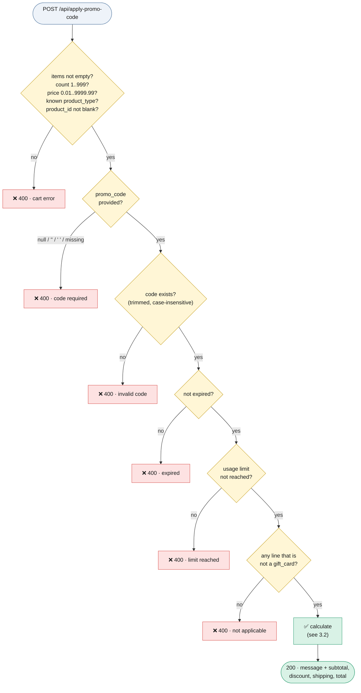
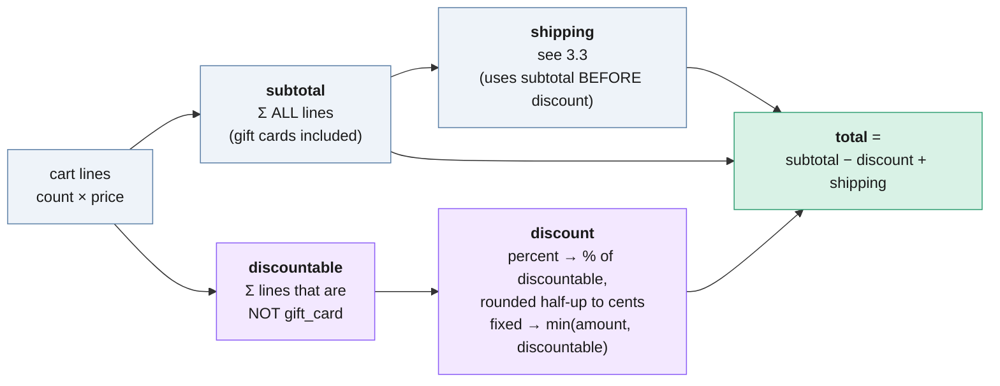
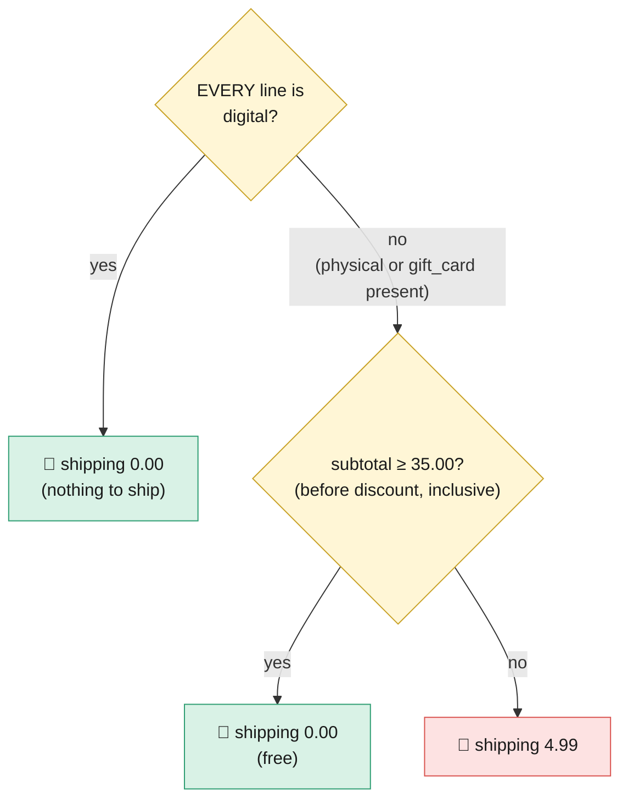
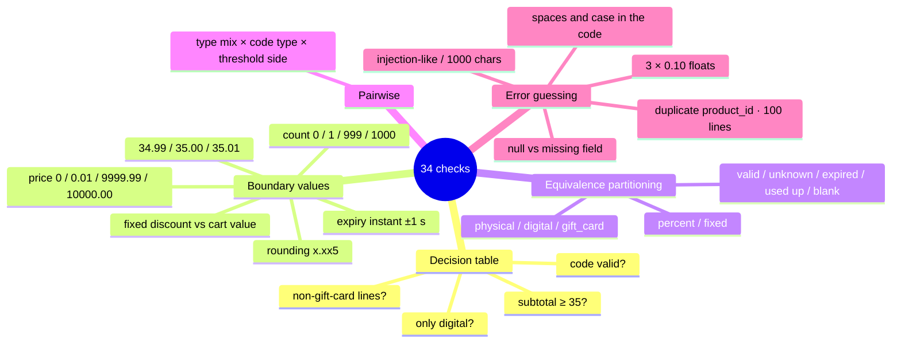

<div align="center">

# 🏷️ Task 2 · `POST /api/apply-promo-code`

**Checklist for the business logic of a promo-code endpoint: discount, gift cards, shipping, validation**


[⬅ Back to the repository overview](../README.md) &nbsp;•&nbsp; [★ Checklist (read on GitHub)](Checklist_EN.md) &nbsp;•&nbsp; [★ Checklist_EN.xlsx](Checklist_EN.xlsx)

</div>

---

## Contents

1. [Deliverables](#1-deliverables)
2. [The task](#2-the-task)
3. [The rules, explained with pictures](#3-the-rules-explained-with-pictures)
   [3.1 How a request is processed](#31-how-a-request-is-processed) · [3.2 The calculation](#32-the-calculation) · [3.3 Shipping](#33-shipping-decision) · [3.4 Worked examples](#34-worked-examples)
4. [Assumptions](#4-assumptions)
5. [How the checklist was designed](#5-how-the-checklist-was-designed)
6. [The checklist at a glance](#6-the-checklist-at-a-glance)
7. [Test cases](#7-test-cases)
8. [Postman collection](#8-postman-collection)
9. [Java automation](#9-java-automation)
10. [How to run](#10-how-to-run)

---

## 1. Deliverables

| | File | What it is |
|:-:|---|---|
| ★ | [`Checklist_EN.xlsx`](Checklist_EN.xlsx) | **The main deliverable.** Sheets: *Checklist* (34 checks `PC-01 … PC-34`), *Assumptions* (13), *Techniques* |
| ★ | [`Checklist_EN.md`](Checklist_EN.md) | The same checklist rendered as Markdown, readable right here on GitHub |
| | [`Additional/Checklist_RU.xlsx`](Additional/Checklist_RU.xlsx) | Russian version of the checklist |
| | [`Additional/Test cases/`](Additional/Test%20cases) | 52 test cases in EN and RU, Azure DevOps import layout |
| | [`Additional/Postman/`](Additional/Postman) | Postman collection (48 requests with test scripts) + *Local* environment |
| | [`Additional/Automation/promo-code-api/`](Additional/Automation/promo-code-api) | Java 17 reference service + 74 REST Assured / JUnit 5 tests + mutation check |

**ID scheme:** checks are `PC-01 … PC-34`; a test case is `PC-<check>.<n>` (`PC-10.2` = second test case of check `PC-10`). The same IDs name the Postman requests and the JUnit tests.

---

## 2. The task

> *Create a checklist for testing the endpoint according to the documentation. Assume that data type validation is already performed at the API gateway level, and the backend is guaranteed to receive correct types. **Focus on the business logic of the promo code.***
> — from [`Задание.pdf`](../Задание.pdf)

<table>
<tr><th>Request</th><th>Response</th></tr>
<tr>
<td>

```json
{
  "promo_code": "string",
  "items": [
    {
      "product_id": "string",
      "product_type": "physical | digital | gift_card",
      "count": 0,
      "price": 0.0
    }
  ]
}
```

</td>
<td>

```json
{
  "result": {
    "message": "string",
    "subtotal": 0.0,
    "discount": 0.0,
    "shipping": 0.0,
    "total": 0.0
  }
}
```

</td>
</tr>
</table>

| Field | Meaning |
|---|---|
| `promo_code`* | promo code entered by the user |
| `items`* | cart lines, **1 or more** |
| `message` | message informing success or error |
| `subtotal` | **sum of all items** |
| `discount` | discount amount applied |
| `shipping` | shipping cost |
| `total` | final amount to pay |

**Business rules (verbatim from the spec):**

| | Rule |
|:-:|---|
| 🎁 | Promo code is **not applicable to `gift_card`** items; they are excluded from the discount calculation. |
| 🚚 | Shipping is **free if the cart subtotal is $35.00 or more**; otherwise it costs **$4.99**. |
| 💾 | Shipping is **not charged if the cart contains only `digital`** items. |
| ➗ | The discount is applied to the **subtotal before shipping**. |

---

## 3. The rules, explained with pictures

### 3.1 How a request is processed

The order of validations is an assumption (#11): **the cart first, then the code**, so one request never gets two different answers depending on the implementation.



> Error responses carry only `result.message` and **no amounts** (assumption #9). The message *texts* are not defined by the spec, so the checklist and test cases do not prescribe them.

### 3.2 The calculation



### 3.3 Shipping decision



**The decision table behind the checklist:**

| # | Code valid | Has non-gift-card lines | Only digital | Subtotal ≥ 35 | → Outcome | Covered by |
|:-:|:-:|:-:|:-:|:-:|---|---|
| 1 | ✗ | – | – | – | 400 error | `PC-17 … PC-23` |
| 2 | ✓ | ✗ (gift cards only) | – | – | 400 not applicable | `PC-07` |
| 3 | ✓ | ✓ | ✓ | any | discount · shipping **0** | `PC-12` |
| 4 | ✓ | ✓ | ✗ | ✗ | discount · shipping **4.99** | `PC-10`, `PC-13`, `PC-15` |
| 5 | ✓ | ✓ | ✗ | ✓ | discount · shipping **0** | `PC-10`, `PC-11`, `PC-14` |

### 3.4 Worked examples

| Cart | Code | subtotal | discount | shipping | total | What it shows |
|---|:-:|:-:|:-:|:-:|:-:|---|
| physical 50.00 | SAVE10 | 50.00 | **5.00** (10 % of 50.00) | 0.00 (≥ 35) | **45.00** | happy path |
| physical 40.00 + gift_card 50.00 | SAVE10 | **90.00** | **4.00** (10 % of 40.00 only) | 0.00 | 86.00 | 🎁 gift card in subtotal, not in discount |
| physical 35.00 | SAVE10 | 35.00 | 3.50 | **0.00** | **31.50** | 🚚 threshold checked **before** the discount (31.50 < 35 does not matter) |
| physical 34.99 | SAVE10 | 34.99 | 3.50 (3.499 → 3.50) | **4.99** | 36.48 | 🚚 just below the threshold |
| digital 10.00 | SAVE10 | 10.00 | 1.00 | **0.00** | 9.00 | 💾 digital only, no shipping |
| digital 20.00 + gift_card 10.00 | SAVE10 | 30.00 | 2.00 | **4.99** | 32.99 | 💾 + 🎁 is **not** “only digital” |
| physical 3.00 | FLAT5 | 3.00 | **3.00** (capped) | 4.99 | 4.99 | fixed discount never exceeds the amount |
| physical 3.00 + gift_card 40.00 | FLAT5 | 43.00 | **3.00** (cap = discountable 3.00) | 0.00 | 40.00 | cap uses non-gift-card lines only |
| physical 10.05 | SAVE10 | 10.05 | **1.01** (1.005 half-up) | 4.99 | 14.03 | ➗ rounding |
| physical 3 × 0.10 | SAVE10 | **0.30** | 0.03 | 4.99 | 5.26 | exact decimals, not 0.30000000000000004 |
| gift_card 50.00 | SAVE10 | – | – | – | – | ❌ 400: nothing to discount |

---

## 4. Assumptions

The spec is short, so several things had to be decided. The two that change the most expected results are marked ⭐: if the product owner decides otherwise, those checks flip.

| # | Topic | Assumption accepted |
|:-:|---|---|
| 1 | Promo codes | Test fixtures: **SAVE10** = 10 % of the discountable amount · **FLAT5** = fixed 5.00 · **EXPIRED20** = expired (2020-01-01) · **USEDUP** = usage limit reached (100/100). One code per request, no stacking |
| 2 | Code normalisation | Case-insensitive; leading/trailing whitespace trimmed; inner spaces and special characters → invalid |
| 3 | Money & rounding | 2 decimals; discount rounded **half-up** to cents; no taxes; `total = subtotal − discount + shipping` |
| 4 | Subtotal | Σ `count × price` over **all** lines incl. gift cards, **before** the discount (“Sum of all items”) |
| 5 | Discountable amount | Non-gift-card lines only; the discount never exceeds it, so the total never drops below shipping |
| 6 ⭐ | Free-shipping threshold | Checked on the **subtotal before the discount**, inclusive (≥ 35.00); shipping itself is never discounted |
| 7 ⭐ | Digital-only cart | Literal reading: free only if **every** line is digital; digital + gift card follows the normal threshold rule |
| 8 | Gift-card-only cart | Error: the code is not applicable (nothing to discount) |
| 9 | Error contract | Success = HTTP 200. Business error = **HTTP 400**, body `{"result": {"message": "..."}}` with **no amounts** |
| 10 | Item limits | `count` integer 1..999; `price` 0.01..9999.99, ≤ 2 decimals; `product_id` not blank; `product_type` exactly `physical` / `digital` / `gift_card`; ≥ 1 line, no upper limit (100 tested) |
| 11 | Validation order | Cart first; then the code: required → exists → not expired → limit → applicable |
| 12 | Applying a code | The endpoint only **calculates**; a use is consumed when the order is placed (out of scope) → stateless and idempotent |
| 13 | Duplicate lines | Allowed; each line priced independently |

---

## 5. How the checklist was designed



| Technique | Applied? | Where and why |
|---|---|---|
| **Decision table** | ✅ **the core** | Conditions *code valid · has non-gift-card lines · digital only · subtotal ≥ 35* → outcomes *error / discount + 0 / discount + 4.99* (table in § 3.3). The ambiguous cell, threshold before or after the discount, is isolated in two dedicated cases. |
| **Boundary value analysis** | ✅ | Threshold `34.99 / 35.00 / 35.01`, `count 0 / 1 / 999 / 1000`, `price 0 / 0.01 / 9999.99 / 10000.00`, the rounding boundary (`x.xx5`), fixed discount vs. cart value (cap), the expiry instant (one second before / at / after). |
| **Equivalence partitioning** | ✅ | Product types, code states (valid / unknown / expired / exhausted / blank), code kinds (percent / fixed), cart compositions. |
| **Pairwise** | ✅ | Factors *type mix (P, D, G, P+D, P+G, D+G) × code kind × threshold side* would give 24 carts; pairwise picked the representative mixed carts instead. |
| **Error guessing** | ✅ | Whitespace/case in the code, injection-like and 1000-character codes, `null` vs missing field, `3 × 0.10`, duplicate `product_id`, 100 lines, cart **and** code invalid at once, 500 instead of 400. |
| **State transition** | ❌ deliberately not | A code has a lifecycle (active → used up → expired), but this endpoint never consumes a use (assumption #12), so there are no transitions to test here. The states are fixtures covered by EP; idempotency is tested instead (`PC-31`). |
| **Mutation check** | ✅ in Java | 17 deliberately broken versions of the service must each be caught (see [§ 9](#9-java-automation)). |

**Priorities:** 🔴 High = wrong money or a valid order blocked; 🟠 Medium = realistic secondary paths; 🟢 Low = defensive / exotic inputs.

---

## 6. The checklist at a glance

Full text (what is checked · expected result · why it matters · technique · priority · linked test cases): **[Checklist_EN.md](Checklist_EN.md)** or **[Checklist_EN.xlsx](Checklist_EN.xlsx)**.

| Area | Checks | What it covers |
|---|:-:|---|
| Discount and totals | `PC-01 … PC-05` | percent and fixed codes; `count × price`; **half-up** rounding; fixed discount **capped** by the cart |
| gift_card | `PC-06 … PC-09` | discount only from non-gift-card lines while the subtotal includes them; **gift-card-only cart rejected**; digital + gift card; cap = discountable amount, not the subtotal |
| Shipping | `PC-10 … PC-16` | threshold **34.99 / 35.00 / 35.01**; threshold **before** the discount; digital-only = free; physical + digital pays; gift cards count towards the threshold; digital + gift card is not “digital only”; shipping added after the discount |
| Promo code | `PC-17 … PC-23` | unknown, expired (incl. **the exact expiry instant**), used-up codes; 4 ways to send “no code”; trim + case-insensitive; hostile input → “invalid”, not 500; no amounts in errors |
| Cart items | `PC-24 … PC-29` | empty cart; `count` and `price` boundaries; unknown / wrong-case type; blank `product_id`; duplicate lines |
| Contract and robustness | `PC-30 … PC-34` | exact response structure and types; idempotent and order-independent; 100 lines; exact decimals; cart error reported before the code error |

---

## 7. Test cases

[`Additional/Test cases/TestCases_EN.xlsx`](Additional/Test%20cases/TestCases_EN.xlsx) (and `_RU`): **52 test cases**, every check covered. Layout ready for **Azure DevOps → Test Plans → Import**:

| ID | Work Item Type | Title | Steps | Step Action | Expected Result |
|---|---|---|:-:|---|---|
| | Test Case | `PC-11.1 - Shipping - FLAT5 on 36.00: subtotal passes the threshold, the discounted 31.00 does not matter - free shipping` | | | |
| | | | 1 | **Precondition.** Promo codes exist: SAVE10 (10 %), FLAT5 (fixed 5.00), EXPIRED20 (expired), USEDUP (limit reached) | – |
| | | | 2 | Send `POST /api/apply-promo-code` with `promo_code = 'FLAT5'; items = physical 1 x 36.00` + the JSON body | HTTP 200 · subtotal = 36.00 · discount = 5.00 (fixed, not more than the discountable 36.00) · shipping = 0.00 (36.00 ≥ 35.00; the threshold is checked on the subtotal **before** the discount, the discounted 31.00 does not matter) · total = 36.00 − 5.00 + 0.00 = **31.00** · message = a success message (its text is not defined by the task) |

Every expected result shows **how** each number is obtained, so a manual tester can verify the response without a calculator and a failure points at the broken rule.

> On import, map *Steps → Step number*, *Step Action → Action*, *Expected Result → Expected* if Azure DevOps does not do it automatically.

---

## 8. Postman collection

[`Additional/Postman/Promo_Code_API.postman_collection.json`](Additional/Postman/Promo_Code_API.postman_collection.json) + [`Local.postman_environment.json`](Additional/Postman/Local.postman_environment.json)

```text
Task 2 - POST /api/apply-promo-code        48 requests · 267 assertions
├── 1. Discount and totals        (9)      PC-01.1 … PC-05.1, PC-32.1, PC-33.1
├── 2. gift_card handling         (5)      PC-06.1 … PC-09.2
├── 3. Shipping                   (7)      PC-10.1 … PC-14.1
├── 4. Promo code validation     (12)      PC-17.1 … PC-22.3
└── 5. Cart items validation     (15)      PC-24.1 … PC-29.1, PC-34.1
```

Every request carries its own test script. A real one (`PC-06.1`, physical 40.00 + gift_card 50.00 with SAVE10):

```js
pm.test('HTTP status is 200', function () { pm.response.to.have.status(200); });
pm.test('Content-Type is JSON', function () { pm.expect(pm.response.headers.get('Content-Type')).to.match(/application\/json/); });
const result = pm.response.json().result;
pm.test('message', function () { pm.expect(result.message).to.eql("Promo code applied successfully"); });
pm.test('subtotal = 90.00', function () { pm.expect(result.subtotal).to.be.a('number'); pm.expect(result.subtotal).to.be.closeTo(90.00, 0.001); });
pm.test('discount = 4.00', function () { pm.expect(result.discount).to.be.a('number'); pm.expect(result.discount).to.be.closeTo(4.00, 0.001); });
// … shipping and total the same way; error cases assert that NO amounts are returned
```

> The message texts (`"Promo code applied successfully"`, `"Promo code is invalid"` …) belong to the reference service, not to the spec. The automation pins them so a regression is visible; the test cases deliberately do not.

**Run in the Postman app**

1. Start the reference service (see [§ 10](#10-how-to-run)); it listens on `http://localhost:8080`.
2. *Import* both JSON files, pick the **Local (reference service)** environment.
3. Collection → **Run**. Expect 48 / 48 requests and 267 / 267 assertions green.
4. To test a real backend, change `baseUrl` in the environment.

**Run from the console**

```bash
npx newman run Postman/Promo_Code_API.postman_collection.json -e Postman/Local.postman_environment.json
```

---

## 9. Java automation

[`Additional/Automation/promo-code-api/`](Additional/Automation/promo-code-api): **Java 17 · JDK `HttpServer` (no framework) · Jackson · JUnit 5 · REST Assured · AssertJ.** Nothing to install except a JDK.

```text
src/main/java/qa/promo/
  PromoApplication.java            HTTP server, POST /api/apply-promo-code (port 8080 or $PORT)
  PromoService.java                validation order + calculation (BigDecimal, HALF_UP)
  InMemoryPromoCodeRepository      SAVE10, FLAT5, EXPIRED20, USEDUP fixtures
  CartItem, RawItem, PromoCode, PricingResult, ProductType, ValidationException
src/test/
  resources/cases.json             48 API cases with the same IDs as the test cases
  java/qa/promo/
    ApplyPromoCodeApiTest          starts the server on a random port, sends every case with REST Assured
    PromoCodeExpiryTest            expiry boundary with a frozen Clock
    PromoMutants + MutationSanityTest
```

| Test class | Tests | What it proves |
|---|:-:|---|
| `ApplyPromoCodeApiTest` | 51 | 48 data-driven API cases + 3 contract checks (exact structure, idempotency, line order does not matter) |
| `PromoCodeExpiryTest` | 5 | A code is valid one second before `expiresAt` and expired **at** that instant and after it (frozen `Clock`) |
| `MutationSanityTest` | 18 | Baseline (the real service passes every case) + each of the **17 broken versions** is caught |
| **Total** | **74** | ✅ 0 failures |

<details>
<summary><b>The 17 mutants the suite must catch</b></summary>

| Mutant | Simulated bug |
|---|---|
| `GIFT_CARDS_ARE_DISCOUNTED` | gift cards included in the discount |
| `GIFT_CARD_ONLY_CART_ACCEPTED_WITH_ZERO_DISCOUNT` | success instead of “not applicable” |
| `FREE_SHIPPING_CHECKED_AFTER_DISCOUNT` | threshold uses the discounted amount |
| `FREE_SHIPPING_STRICT` | `> 35.00` instead of `≥` |
| `DIGITAL_ONLY_CART_STILL_CHARGED_SHIPPING` | digital rule missing |
| `GIFT_CARD_TREATED_AS_DIGITAL_FOR_SHIPPING` | digital + gift card ships free |
| `DISCOUNT_ROUNDED_DOWN` | instead of half-up |
| `DISCOUNT_NOT_CAPPED` | total can drop below shipping |
| `DISCOUNT_CAP_USES_WHOLE_SUBTOTAL` | cap includes gift cards |
| `PERCENT_DISCOUNT_TAKEN_FROM_SUBTOTAL_PLUS_SHIPPING` | discount after shipping |
| `PROMO_CODE_CASE_SENSITIVE` / `PROMO_CODE_NOT_TRIMMED` | normalisation missing |
| `EXPIRED_CODE_ACCEPTED` / `USAGE_LIMIT_IGNORED` | code state ignored |
| `ITEM_COUNT_UPPER_LIMIT_IS_1000` | off-by-one on `count` |
| `PRICE_DECIMAL_PLACES_NOT_VALIDATED` | `10.001` accepted |
| `COUNT_IGNORED_IN_LINE_TOTAL` | `price` instead of `count × price` |

</details>

> [!NOTE]
> No real backend exists for this task, so the service under test is a small **reference implementation of the spec plus the assumptions above**. Green tests mean the checklist is executable and catches real defects; to test an actual backend, point the Postman environment at it.

---

## 10. How to run

**Everything at once** (both tasks, incl. Newman) from the repository root: `run-all.cmd` (Windows, double-click) or `./run-all.sh`. See the [root README](../README.md#-quick-start).

**Only Task 2, by hand:**

```bash
cd "Task 2/Additional/Automation/promo-code-api"
./mvnw test                     # Java tests; they start the service themselves (Windows: .\mvnw.cmd test)

./mvnw compile exec:java        # or: start the service for Postman / Newman on http://localhost:8080
                                #     (another port: PORT=8090 ./mvnw compile exec:java)
```

Then, in a second terminal:

```bash
cd "Task 2/Additional"
npx newman run Postman/Promo_Code_API.postman_collection.json -e Postman/Local.postman_environment.json
```

A quick manual call:

```bash
curl -s -X POST http://localhost:8080/api/apply-promo-code -H "Content-Type: application/json" \
  -d '{"promo_code":"SAVE10","items":[{"product_id":"A","product_type":"physical","count":1,"price":40.00},{"product_id":"G","product_type":"gift_card","count":1,"price":50.00}]}'
# {"result":{"message":"Promo code applied successfully","subtotal":90.00,"discount":4.00,"shipping":0.00,"total":86.00}}
```

<div align="center">
<br>

[⬅ Task 1 · Packaging](../Task%201/README.md) &nbsp;&nbsp;•&nbsp;&nbsp; [Repository overview](../README.md)

</div>
